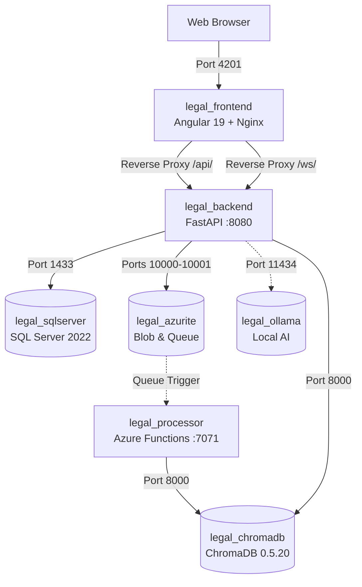

# Enterprise Legal Contract RAG & Assistant Platform

[](docs/architecture.md)
[](docs/api.md)
[](frontend/)
[](backend/)
[](docs/rag_pipeline.md)
[](docs/database.md)
[](docs/agent_mcp.md)

An enterprise-ready, modular **Retrieval-Augmented Generation (RAG)** platform and **MCP-based Agent Assistant** engineered for corporate legal departments, procurement teams, and compliance officers. Built to automate legal contract ingestion, structural clause parsing, amendment hierarchy resolution, and verified citation-backed question answering.

---

## 🏛️ Comprehensive Documentation Suite

For exhaustive technical specifications, refer to our modular documentation directory:

| Document | Focus & Contents |
|---|---|
| 📐 [**System Architecture (`docs/architecture.md`)**](docs/architecture.md) | Distributed microservices topology, component responsibilities, trust boundaries, sequence diagrams, and fault-tolerance matrix. |
| 🔌 [**REST & WebSocket API (`docs/api.md`)**](docs/api.md) | Complete OpenAPI endpoint catalog, request/response JSON schemas, WebSocket events, and RFC 7807 error specifications. |
| 🗄️ [**Database Architecture (`docs/database.md`)**](docs/database.md) | SQL Server 2022 relational schema, ER diagrams, table dictionaries, foreign key cascading rules, and Alembic migrations. |
| 🧠 [**Legal AI & RAG Pipeline (`docs/rag_pipeline.md`)**](docs/rag_pipeline.md) | Document extraction, `LegalAwareChunker`, dynamic embedding providers, self-healing ChromaDB vector storage, hybrid RRF search, and prompt versioning. |
| 🤖 [**Agent Subsystem & MCP (`docs/agent_mcp.md`)**](docs/agent_mcp.md) | ReAct reasoning loops, deterministic workflows, multi-agent coordination, Model Context Protocol (MCP JSON-RPC 2.0), and legal advice guardrails. |
| 🚀 [**Deployment & Operations (`docs/deployment.md`)**](docs/deployment.md) | Docker Compose infrastructure topology, environment variables matrix, local dev guides, and operations troubleshooting playbook. |

---

## 🌟 Key Platform Capabilities

- **Temporal Grounding & Amendment Hierarchy**: Prioritizes later executed amendments over earlier baseline provisions (e.g. Northwind Amendment No. 2 strictly overrides legacy base provisions).
- **Dynamic Multi-Provider AI Engine**: Hot-swap between **Google Gemini** (`gemma-4-26b-a4b-it`, `gemini-embedding-001`), **Local Ollama** (`llama3.2`, `nomic-embed-text`), **OpenRouter**, or **OpenAI** with zero codebase modifications.
- **Decoupled Model Context Protocol (MCP)**: Zero hardcoded tools in agent prompts. All tool bindings and parameter schemas are discovered dynamically at runtime via MCP JSON-RPC 2.0.
- **Structural Legal Parsing**: `LegalAwareChunker` captures Articles, Sections, Clauses, Recitals, Definitions, and Schedules, preventing naive mid-sentence splits.
- **Self-Healing Vector Store**: Automatic dimensionality synchronization in ChromaDB (768 for Ollama vs 3072 for Gemini) preventing runtime dimensionality mismatch crashes.
- **Dual-Mode Conversational Routing**: Dynamically handles casual greetings (`hi`, `hii`, `heyy`) and assistant capability questions directly through the LLM while routing contractual queries through grounded retrieval.
- **Deterministic Legal Advice Guardrail**: Deterministic regex interceptors short-circuit inquiries regarding whether clauses are "acceptable", "standard", or "fair", redirecting users to licensed legal counsel.
- **Real-Time Job Tracking**: Full-duplex WebSocket connection streaming document processing progress (`Uploaded` $\to$ `Processing` $\to$ `Completed`) to the UI.

---

## 🚢 Service Topology & Port Map

The system deploys as 7 containerized services connected over an internal Docker bridge network:



| Container Name | Service | Technology | Exposed Port | Purpose |
|---|---|---|---|---|
| `legal_frontend` | Web UI | Angular 19 + Nginx | **`4201`** | Interactive Legal Assistant UI & Management Portal |
| `legal_backend` | REST API | FastAPI + SQLAlchemy | **`8080`** | Primary Application Gateway & RAG Orchestrator |
| `legal_processor`| Background Worker | Azure Functions Python v2 | **`7071`** | Document Extraction, Structural Chunking & Ingestion |
| `legal_chromadb` | Vector Database | ChromaDB 0.5.20 | **`8000`** | Dense Vector Cosine Similarity Search |
| `legal_sqlserver`| Relational DB | Microsoft SQL Server 2022 | **`1433`** | Relational Ledger (Contracts, Documents, Chats) |
| `legal_azurite`  | Storage Emulator| Azurite | **`10000-10002`**| Azure Blob (10000) & Azure Queue (10001) Storage |
| `legal_ollama`   | Offline AI Host | Ollama | **`11434`** | Local LLM & Embedding Service (Offline fallback) |

---

## ⚡ Quick Start: 3-Minute Docker Deployment

### 1. Prerequisites
- Docker Desktop 4.25+ (Windows / macOS / Linux) with Docker Compose enabled.
- Git.

### 2. Configure Environment Secrets
Ensure `.env` at the root contains your active AI provider configuration:
```bash
# Active AI Provider: GEMINI, OLLAMA, OPENROUTER, OPENAI
AI_PROVIDER=GEMINI
LLM_PROVIDER=GEMINI
AI_API_KEY=your-gemini-api-key-here
API_KEY=your-gemini-api-key-here
LLM_MODEL=gemma-4-26b-a4b-it
EMBEDDING_MODEL=gemini-embedding-001
```

### 3. Build & Launch the Stack
```powershell
docker-compose up -d --build
```

### 4. Verify System Health
Verify all services are up and healthy:
```powershell
curl http://localhost:8080/health
# Expected: {"status": "healthy", "environment": "development", "version": "2.0.0", "active_llm": {"status": "healthy", "provider": "gemini", "model": "gemma-4-26b-a4b-it"}}
```

Access the applications:
- **Angular Web UI**: [`http://localhost:4201`](http://localhost:4201)
- **FastAPI Interactive Docs**: [`http://localhost:8080/docs`](http://localhost:8080/docs)

### 5. Ingest Sample Legal Corpus
Upload and index the Northwind Logistics Master Services Agreement Suite:
```powershell
python scripts/ingest_shared_corpus_to_ui.py
```

---

## 💻 Local Development Setup (Without Docker)

### Backend API (FastAPI)
```powershell
# Create and activate virtual environment
python -m venv .venv
.\.venv\Scripts\Activate.ps1

# Install dependencies
pip install -r backend/requirements.txt

# Run migrations
alembic upgrade head

# Start development server
uvicorn backend.app.main:app --host 0.0.0.0 --port 8000 --reload
```

### Document Processor (Azure Functions)
```powershell
cd processor
pip install -r requirements.txt
func start --port 7071
```

### Frontend Application (Angular 19)
```powershell
cd frontend
npm install

# Start development server on port 4201 with backend proxy
npm start
```

---

## 🧪 Testing & Quality Assurance

All unit and integration tests are consolidated in the root [`tests/`](tests/) directory:

```powershell
# Run complete core test suite
$env:PYTHONPATH="."; .venv\Scripts\pytest.exe -o cache_dir=.pytest_cache_local tests/ -v
```

### Test Suite Directory

| Test File | Target Subsystem |
|---|---|
| `test_clean_domain.py` | Domain entities, value objects, and lifecycle validations. |
| `test_clean_use_cases.py` | Contract and document use cases, validation, and mocking. |
| `test_embedding_strategy.py` | Pluggable embedding factory delegation (Gemini, Ollama, OpenAI). |
| `test_hybrid_rag.py` | BM25 lexical search, Reciprocal Rank Fusion, and scoping isolation. |
| `test_llm_providers.py` | LLM conformance, error mappings, and factory switching. |
| `test_rag_pipeline.py` | Grounded RAG synthesis, prompt assembly, and output validation. |
| `test_mcp.py` | Model Context Protocol dynamic discovery, wire tracing, and safety guardrails. |
| `test_multi_agent.py` | Multi-agent orchestrator, worker delegations, and failure injectors. |
| `test_production.py` | End-to-end integration workflows, evaluation benchmarks, and cost analysis. |

---

## 🔧 Operations & Troubleshooting

- **Frontend Port**: The frontend runs on **port 4201** (`http://localhost:4201`). If you experience collisions on port 4200 from other applications, our Docker stack and Angular dev server are explicitly pre-configured to port 4201.
- **Dimensionality Error**: If switching between Ollama (768) and Gemini (3072) embeddings, the processor automatically recreates the ChromaDB collection. Trigger re-processing via `POST /api/v1/documents/{document_id}/reprocess`.
- **SQL Server SA Password**: Ensure `MSSQL_SA_PASSWORD` meets Microsoft complexity standards (uppercase, lowercase, numbers, special characters).
- **Log Inspection**:
  ```powershell
  docker logs -f legal_backend --tail 50
  docker logs -f legal_processor --tail 50
  docker logs -f legal_chromadb --tail 50
  ```
