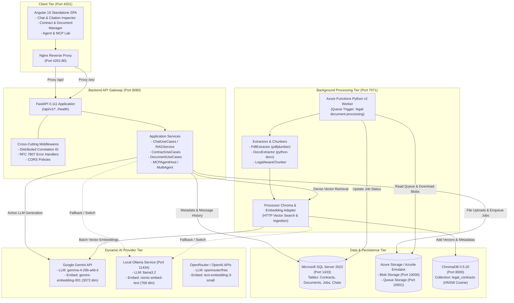
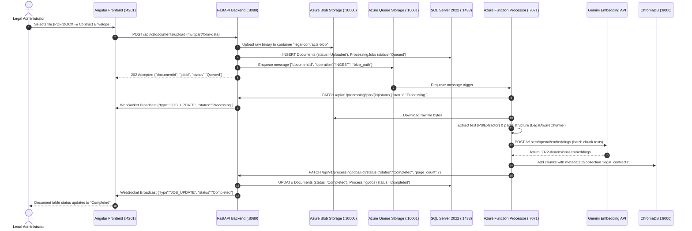
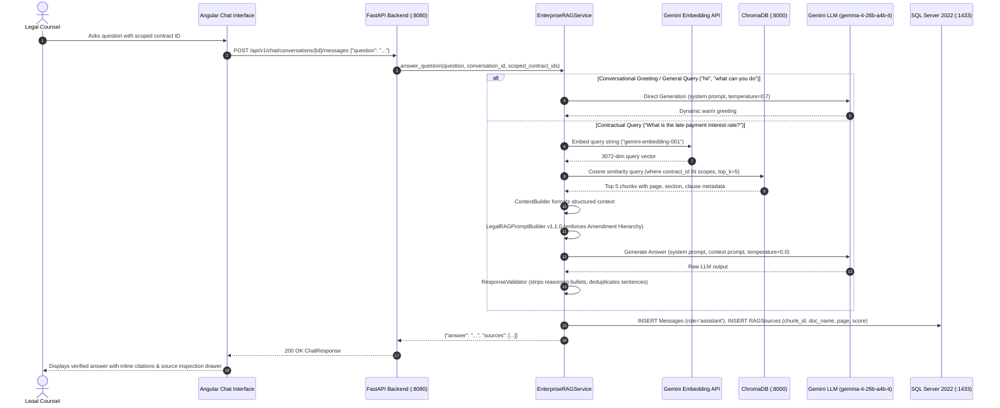
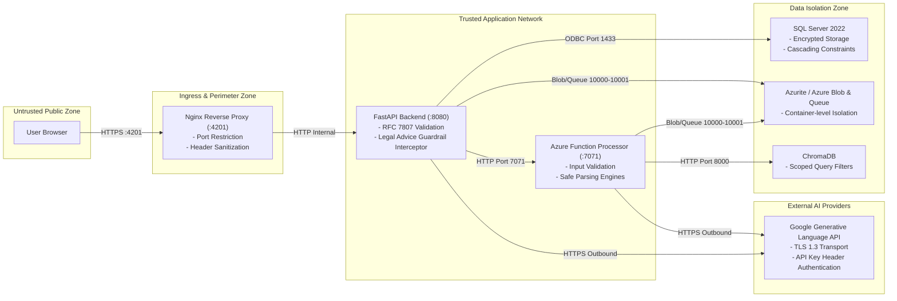

# Enterprise System Architecture Document

**System Name**: Enterprise Legal Contract Review Assistant & Grounded RAG Platform  
**Architecture Style**: Distributed Microservices & Hexagonal (Ports & Adapters) Clean Architecture  
**Document Version**: `2.0.0` (Production Reference Architecture)  
**Date**: November 2026  

> [!NOTE]
> This canonical document specifies the end-to-end architecture of the Legal Contract RAG & Assistant System. For specialized modular specifications, see:
> - [`docs/api.md`](docs/api.md) — Complete REST & WebSocket API Specification
> - [`docs/database.md`](docs/database.md) — SQL Server Schema & Entity Relationship Specification
> - [`docs/rag_pipeline.md`](docs/rag_pipeline.md) — Ingestion, Chunking, Embeddings, & Grounded Retrieval
> - [`docs/agent_mcp.md`](docs/agent_mcp.md) — ReAct Agent, Multi-Agent Orchestration, & Model Context Protocol (MCP)
> - [`docs/deployment.md`](docs/deployment.md) — Docker Compose Infrastructure, Environment Variables, & Runbooks

---

## 1. System Overview & Core Architectural Principles

The Enterprise Legal Contract Review Assistant is an AI-powered system designed for corporate legal departments, procurement teams, and compliance officers. It automates contract ingestion, structural clause parsing, temporal amendment supersession resolution, and grounded question answering with precise citations.

### Core Architectural Principles:

1. **Hexagonal Clean Architecture**:
   Domain logic (entities, validation, value objects) is decoupled from external frameworks, databases, and LLM providers. Adapters implement domain ports via inversion of control, ensuring testability and longevity.

2. **Decoupled Agent-Tool Boundary (Model Context Protocol)**:
   The agent host contains zero hardcoded tool definitions. All capabilities, parameter schemas, and documentation are discovered dynamically at runtime from independent MCP servers via JSON-RPC 2.0.

3. **Temporal Grounding & Amendment Hierarchy**:
   Legal contracts operate under an amendment hierarchy. The system prioritizes later executed amendments over earlier baseline provisions, guaranteeing that superseded terms are never cited as governing obligations.

4. **Dynamic AI Provider Agnosticism**:
   Eliminates single-vendor AI lock-in. A unified provider abstraction layer supports switching between Google Gemini, local Ollama, OpenRouter, and OpenAI through configuration variables without changing application code.

5. **Asynchronous Decoupled Ingestion**:
   Heavy document extraction, OCR, structural chunking, and vector embedding are offloaded to an asynchronous Azure Functions queue worker, ensuring web API responsiveness and system scalability.

---

## 2. High-Level Architecture Diagram

---

## 3. Component Responsibilities & Technology Stack

| Layer / Component | Technology | Responsibilities |
|---|---|---|
| **Frontend SPA** | Angular 19, TypeScript 5.5, Tailwind CSS, RxJS | Interactive legal chat, contract and document management, real-time WebSocket job tracking, grounded source citation drawer, agent experimental lab. |
| **Ingress Proxy** | Nginx Alpine (Docker) | Static asset serving, SSL/TLS termination, reverse proxy routing for `/api/` (HTTP) and `/ws/` (WebSocket). |
| **Backend API Gateway** | FastAPI, Python 3.11, Uvicorn | Request validation (Pydantic V2), correlation ID injection, RFC 7807 problem details formatting, business use case orchestration. |
| **RAG Orchestrator** | `EnterpriseRAGService`, `ContextBuilder`, `ResponseValidator` | Conversational routing, hybrid retrieval fusion (BM25 + Dense vector), amendment hierarchy enforcement, reasoning trace normalization. |
| **Agent Subsystem** | `ReActAgent`, `FixedDeterministicWorkflow`, `MultiAgentOrchestrator` | Iterative Thought-Action-Observation loops, deterministic workflows, multi-agent worker delegations, budget tracking, prompt injection testing. |
| **MCP Host & Servers** | `MCPAgentHost`, `MCPClientManager`, `ClauseServer`, `RepoServer` | Decoupled runtime tool discovery over JSON-RPC 2.0, wire tracing, deterministic legal advice refusal guardrails. |
| **Document Processor** | Azure Functions Python v2 Worker | Asynchronous queue-triggered worker, document extraction (PDF/DOCX/TXT), structural legal chunking, vector embedding generation. |
| **Relational Database** | Microsoft SQL Server 2022 | Entity metadata persistence, relational integrity, foreign key cascading, conversation history, audit logging. |
| **Object & Queue Storage** | Azure Storage / Azurite Emulator | Binary contract storage (Blob Storage), resilient job dispatch and retry management (Queue Storage). |
| **Vector Database** | ChromaDB 0.5.20 | Cosine similarity vector indexing, metadata filtering by contract/document, self-healing dimension harmonization. |
| **AI Provider Layer** | Google Gemini (REST API), Ollama, OpenRouter | Active model hosting: `gemma-4-26b-a4b-it` (text generation) and `gemini-embedding-001` (embeddings). |

---

## 4. End-to-End System Workflows

### 4.1 Document Ingestion & Vector Indexing Workflow

---

### 4.2 Grounded Contract Question Answering Workflow

---

## 5. Trust Boundaries, Security & Fault Tolerance

### 5.1 Fault Tolerance & Self-Healing Matrix

| Failure Mode | Detection Mechanism | Automated Mitigation |
|---|---|---|
| **ChromaDB Dimension Mismatch** | `InvalidCollectionException` / `Dimensionality error` on insert or query | `ProcessorChromaService` catches error, drops the obsolete collection, and recreates it matching the incoming dimension (e.g. 3072). |
| **Model 500 Error from Google API** | HTTP 500 status returned by Generative Language API | `GeminiProvider` detects 500 and attempts automatic fallback across candidate models (`gemini-3.5-flash`, `gemini-flash-latest`). |
| **Document Parsing Crash** | Unhandled exception in PDF/DOCX extractor | Worker catches exception, updates `ProcessingJobs.status = 'Failed'` with stack trace, updates `Documents.status = 'Failed'`, and notifies UI via WebSockets. |
| **Reasoning Model Thought Leakage** | Leading `<think>` tags or bulleted thought traces in raw generation | `ResponseValidator` strips think blocks, parses draft candidates, and deduplicates consecutive duplicate sentences. |
| **Unauthorized Legal Advice Query** | Pattern match on queries asking if clauses are "acceptable", "standard", or "fair" | `MCPGateway` immediately short-circuits the query, returning a safe legal disclaimer without invoking the LLM. |
