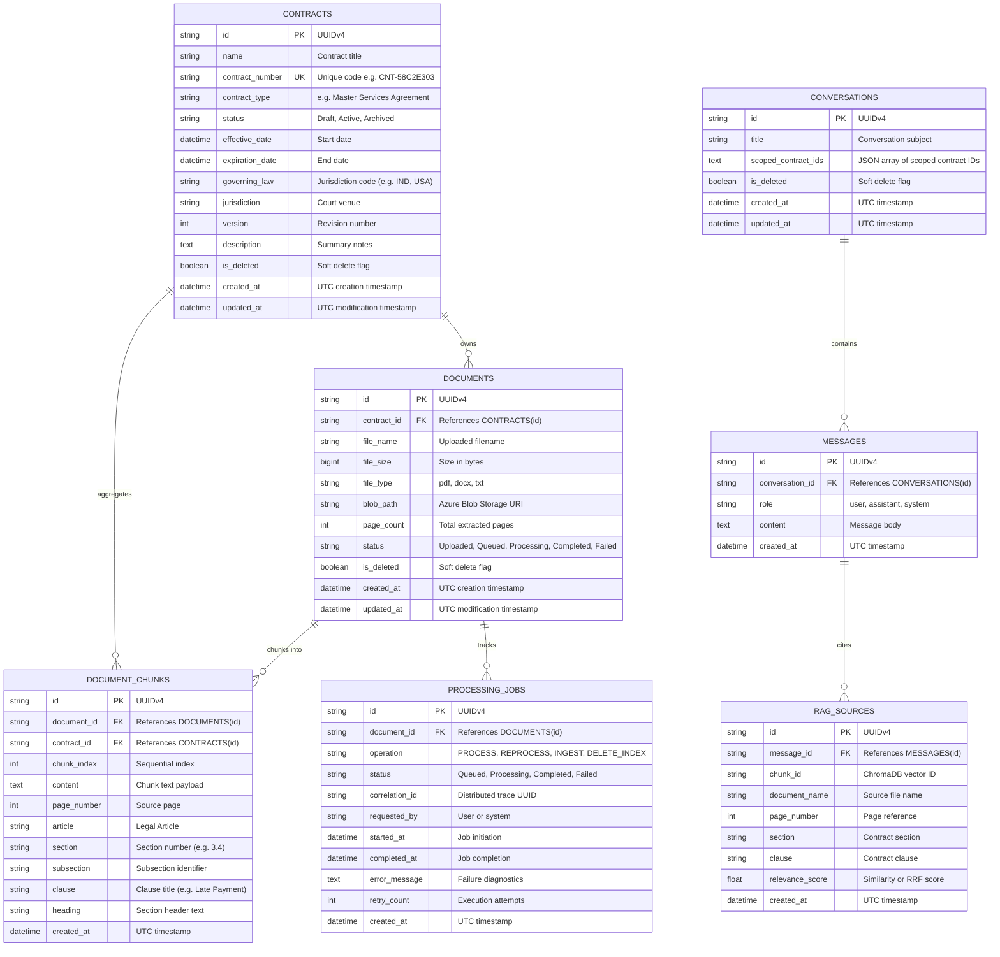

# Database Architecture & Entity Relationship Specification

**Database Engine**: Microsoft SQL Server 2022 (`mcr.microsoft.com/mssql/server:2022-latest`)  
**Database Name**: `LegalContractRAG`  
**ORM Layer**: SQLAlchemy 2.0 (Declarative Mapping)  
**Migration Tool**: Alembic  
**Driver**: Microsoft ODBC Driver 17 for SQL Server (`mssql+pyodbc`)  
**Default Port**: `1433`  

---

## 1. Architectural Overview & Design Decisions

The persistence layer is structured to support enterprise multi-contract ingestion, document versioning, asynchronous job tracking, and conversational audit trails with granular chunk-level citations.

### Core Architectural Decisions:
1. **UUIDv4 Primary Keys**: All entity identifiers use 36-character string representations of UUIDv4 (`String(36)`), ensuring decentralized key generation across microservices and eliminating database sequence contention.
2. **Cascading Relational Deletions**: Deleting a `Contract` cascades automatically across `Documents` and `DocumentChunks`. Similarly, deleting a `Document` cascades down to its `ProcessingJobs` and `DocumentChunks`.
3. **Auditing & Timestamps**: All major business tables implement standardized UTC timestamps (`created_at` and `updated_at`).
4. **Soft Deletion**: `Contracts`, `Documents`, and `Conversations` include an `is_deleted` boolean flag for compliant retention and fast recovery.
5. **Decoupled Relational vs. Vector Storage**: Metadata and business records reside in SQL Server; dense vector embeddings and similarity indexing reside in ChromaDB, connected via shared `document_id` and `contract_id` keys.

---

## 2. Entity-Relationship (ER) Diagram



---

## 3. Data Dictionary & Table Schemas

### 3.1 `Contracts` Table
Stores contract entities, classification metadata, and governing law boundaries.

| Column | Type | Constraints | Description |
|---|---|---|---|
| `id` | `VARCHAR(36)` | PRIMARY KEY | Unique identifier (UUIDv4). |
| `name` | `VARCHAR(255)` | NOT NULL | Human-readable contract title. |
| `contract_number` | `VARCHAR(100)` | UNIQUE, INDEX, NULLABLE | Internal reference number (e.g., `CNT-58C2E303`). |
| `contract_type` | `VARCHAR(100)` | INDEX, NULLABLE | Type (e.g., `Master Services Agreement`, `NDA`). |
| `status` | `VARCHAR(50)` | NOT NULL, DEFAULT `'Draft'` | Status (`Draft`, `Active`, `Archived`, `Terminated`). |
| `effective_date` | `DATETIME` | NULLABLE | Date when terms become binding. |
| `expiration_date`| `DATETIME` | NULLABLE | Contract expiration or renewal deadline. |
| `governing_law` | `VARCHAR(150)` | NULLABLE | Governing legal jurisdiction (e.g., `IND`, `USA`, `GBR`, `SGP`). |
| `jurisdiction` | `VARCHAR(150)` | NULLABLE | City or arbitral body (e.g., `New Delhi`, `SIAC`). |
| `version` | `INT` | NOT NULL, DEFAULT `1` | Incremental revision number. |
| `description` | `NVARCHAR(MAX)`| NULLABLE | Executive overview and scope notes. |
| `is_deleted` | `BIT` | NOT NULL, DEFAULT `0` | Soft delete flag. |
| `created_at` | `DATETIME` | NOT NULL, DEFAULT `GETUTCDATE()` | Creation timestamp. |
| `updated_at` | `DATETIME` | NOT NULL, DEFAULT `GETUTCDATE()` | Modification timestamp. |

---

### 3.2 `Documents` Table
Represents concrete files attached to contracts and stored in Azure Blob Storage.

| Column | Type | Constraints | Description |
|---|---|---|---|
| `id` | `VARCHAR(36)` | PRIMARY KEY | Unique identifier (UUIDv4). |
| `contract_id` | `VARCHAR(36)` | FOREIGN KEY (`Contracts.id` ON DELETE CASCADE), INDEX | Parent contract envelope. |
| `file_name` | `VARCHAR(255)` | NOT NULL | File name with extension (e.g., `MSA-2026-014.pdf`). |
| `file_size` | `BIGINT` | NOT NULL | File size in bytes. |
| `file_type` | `VARCHAR(50)` | NOT NULL | Format extension (`pdf`, `docx`, `txt`). |
| `blob_path` | `VARCHAR(1000)`| NOT NULL | Azure Blob Storage object URI. |
| `page_count` | `INT` | NOT NULL, DEFAULT `0` | Total extracted pages. |
| `status` | `VARCHAR(50)` | NOT NULL, DEFAULT `'Uploaded'` | Status (`Uploaded`, `Queued`, `Processing`, `Completed`, `Failed`). |
| `is_deleted` | `BIT` | NOT NULL, DEFAULT `0` | Soft delete flag. |
| `created_at` | `DATETIME` | NOT NULL, DEFAULT `GETUTCDATE()` | Upload timestamp. |
| `updated_at` | `DATETIME` | NOT NULL, DEFAULT `GETUTCDATE()` | Status update timestamp. |

---

### 3.3 `DocumentChunks` Table
Relational representation of text segments parsed by the `LegalAwareChunker`.

| Column | Type | Constraints | Description |
|---|---|---|---|
| `id` | `VARCHAR(36)` | PRIMARY KEY | Unique chunk ID (UUIDv4). |
| `document_id` | `VARCHAR(36)` | FOREIGN KEY (`Documents.id` ON DELETE CASCADE), INDEX | Originating document. |
| `contract_id` | `VARCHAR(36)` | FOREIGN KEY (`Contracts.id` ON DELETE CASCADE), INDEX | Scoped contract envelope. |
| `chunk_index` | `INT` | NOT NULL | Sequential chunk order inside document. |
| `content` | `NVARCHAR(MAX)`| NOT NULL | Cleaned raw text chunk content. |
| `page_number` | `INT` | NULLABLE | Document page number where chunk originates. |
| `article` | `VARCHAR(100)` | NULLABLE | Top-level Article (e.g., `Article III`). |
| `section` | `VARCHAR(100)` | NULLABLE | Section number (e.g., `3.4`). |
| `subsection` | `VARCHAR(100)` | NULLABLE | Sub-clause identifier (e.g., `(a)`). |
| `clause` | `VARCHAR(100)` | NULLABLE | Clause title (e.g., `Late Payment`). |
| `heading` | `VARCHAR(255)` | NULLABLE | Heading banner preceding the text. |
| `created_at` | `DATETIME` | NOT NULL, DEFAULT `GETUTCDATE()` | Insertion timestamp. |

---

### 3.4 `ProcessingJobs` Table
Audit ledger for tracking asynchronous document processing pipeline tasks.

| Column | Type | Constraints | Description |
|---|---|---|---|
| `id` | `VARCHAR(36)` | PRIMARY KEY | Job identifier (UUIDv4). |
| `document_id` | `VARCHAR(36)` | FOREIGN KEY (`Documents.id` ON DELETE CASCADE), INDEX | Associated target document. |
| `operation` | `VARCHAR(50)` | NOT NULL | Operation (`PROCESS`, `REPROCESS`, `INGEST`, `DELETE_INDEX`). |
| `status` | `VARCHAR(50)` | NOT NULL, DEFAULT `'Queued'` | State (`Queued`, `Processing`, `Completed`, `Failed`). |
| `correlation_id`| `VARCHAR(36)`| NOT NULL | Distributed request trace ID. |
| `requested_by` | `VARCHAR(100)` | NULLABLE | Originator (e.g., `user`, `system`). |
| `started_at` | `DATETIME` | NULLABLE | Timestamp when worker initiated processing. |
| `completed_at` | `DATETIME` | NULLABLE | Timestamp when processing concluded. |
| `error_message`| `NVARCHAR(MAX)`| NULLABLE | Detailed stack trace or reason on failure. |
| `retry_count` | `INT` | NOT NULL, DEFAULT `0` | Number of execution retries attempted. |
| `created_at` | `DATETIME` | NOT NULL, DEFAULT `GETUTCDATE()` | Creation timestamp. |

---

### 3.5 `Conversations` Table
Maintains multi-turn chat sessions and contract isolation scopes.

| Column | Type | Constraints | Description |
|---|---|---|---|
| `id` | `VARCHAR(36)` | PRIMARY KEY | Conversation session ID (UUIDv4). |
| `title` | `VARCHAR(255)` | NOT NULL | Thread title or auto-generated query summary. |
| `scoped_contract_ids` | `NVARCHAR(MAX)` | NULLABLE | JSON array string of contract UUIDs restricting retrieval. |
| `is_deleted` | `BIT` | NOT NULL, DEFAULT `0` | Soft delete flag. |
| `created_at` | `DATETIME` | NOT NULL, DEFAULT `GETUTCDATE()` | Thread creation timestamp. |
| `updated_at` | `DATETIME` | NOT NULL, DEFAULT `GETUTCDATE()` | Last message activity timestamp. |

---

### 3.6 `Messages` Table
Stores chronological dialogue history for each conversation.

| Column | Type | Constraints | Description |
|---|---|---|---|
| `id` | `VARCHAR(36)` | PRIMARY KEY | Message identifier (UUIDv4). |
| `conversation_id` | `VARCHAR(36)`| FOREIGN KEY (`Conversations.id` ON DELETE CASCADE), INDEX | Parent conversation. |
| `role` | `VARCHAR(20)` | NOT NULL | Author role (`user`, `assistant`, `system`). |
| `content` | `NVARCHAR(MAX)`| NOT NULL | Message body (Markdown text). |
| `created_at` | `DATETIME` | NOT NULL, DEFAULT `GETUTCDATE()` | Message timestamp. |

---

### 3.7 `RAGSources` Table
Persists verifiable legal citations and retrieved chunks linked to each assistant message.

| Column | Type | Constraints | Description |
|---|---|---|---|
| `id` | `VARCHAR(36)` | PRIMARY KEY | Source reference ID (UUIDv4). |
| `message_id` | `VARCHAR(36)` | FOREIGN KEY (`Messages.id` ON DELETE CASCADE), INDEX | Associated assistant message. |
| `chunk_id` | `VARCHAR(255)` | NULLABLE | ChromaDB vector chunk ID. |
| `document_name`| `VARCHAR(255)` | NOT NULL | Name of referenced document file. |
| `page_number` | `INT` | NULLABLE | Document page number containing the citation. |
| `section` | `VARCHAR(100)` | NULLABLE | Section reference (e.g., `3.4`). |
| `clause` | `VARCHAR(100)` | NULLABLE | Clause name (e.g., `Late Payment`). |
| `relevance_score` | `FLOAT` | NULLABLE | Cosine similarity score or RRF fusion metric. |
| `created_at` | `DATETIME` | NOT NULL, DEFAULT `GETUTCDATE()` | Insertion timestamp. |

---

## 4. Database Migrations & Initialization

Database schema migrations are managed using **Alembic**.

### Migration Workflow Commands:

```bash
# Execute latest migrations against configured SQL Server
alembic upgrade head

# Generate a new migration revision after model updates
alembic revision --autogenerate -m "add_column_name_to_table"

# Rollback single migration step
alembic downgrade -1
```

### Docker Container Auto-Migration:
On container startup (`docker-compose up`), `legal_backend` executes `alembic upgrade head` automatically via [`backend/entrypoint.sh`](file:///backend/entrypoint.sh), ensuring the schema is always synchronized prior to serving API traffic.

