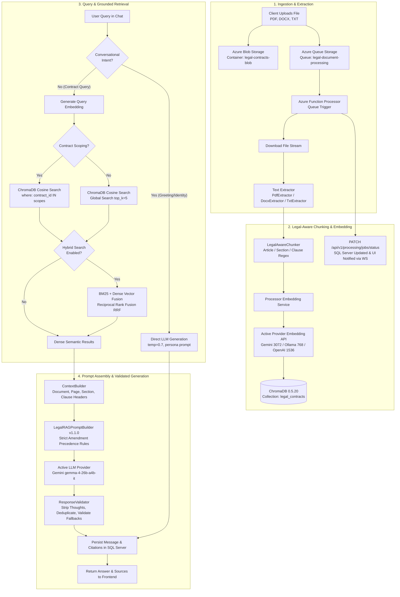

# Legal AI & RAG Pipeline Specification

**Pipeline Version**: `2.0.0` (Production Dynamic AI Provider Architecture)  
**Supported AI Providers**: Google Gemini, Local Ollama, OpenRouter, OpenAI  
**Active AI Provider**: Google Gemini (`gemma-4-26b-a4b-it` LLM, `gemini-embedding-001` Embeddings)  
**Vector Store**: ChromaDB 0.5.20 (`legal_chromadb:8000`)  

---

## 1. End-to-End Pipeline Architecture

The Legal Contract RAG pipeline provides grounded, citation-backed answers to complex contractual inquiries, enforces temporal amendment precedence, and eliminates hallucinations.



---

## 2. Ingestion & Document Processing

### 2.1 Supported Document Extractors
File extraction is managed by [`processor/extractors`](file:///processor/extractors):

| Format | Extractor Class | Implementation Details |
|---|---|---|
| **PDF** (`.pdf`) | `PdfExtractor` | Primary engine `pdfplumber` for precise character coordinate extraction and table layouts; fallback to `pypdf`/`PyPDF2`. Extracts text page-by-page preserving page numbers. |
| **DOCX** (`.docx`)| `DocxExtractor` | Uses `python-docx` to iterate through document paragraphs and embedded table cells, maintaining heading hierarchy. |
| **TXT** (`.txt`) | `TxtExtractor` | Detects character encodings (`utf-8`, `latin-1`, `cp1252`) and extracts raw text. |

### 2.2 Legal-Aware Structural Chunking (`LegalAwareChunker`)
Standard naive chunking (fixed token windows) breaks legal clauses mid-sentence, causing loss of critical contractual conditions (e.g., separating indemnification obligations from their limitations).

The **`LegalAwareChunker`** parses legal documents using structural regex boundaries:
1. **Article Detection**: `^ARTICLE\s+([IVXLCDM\d]+)[\.\:\s]*(.*)$`
2. **Section Detection**: `^(?:SECTION\s+)?(\d+\.\d+)[\.\:\s]*(.*)$` (e.g., `Section 3.4 Late Payment`)
3. **Subsection Detection**: `^\s*(\([a-z\d]+\))\s*(.*)$`
4. **Recitals & Definitions**: Captures `WHEREAS` clauses and quoted defined terms (`"Confidential Information" means...`).
5. **Amendment Chains**: Detects amendment headers (`AMENDMENT NO. 1 TO MASTER SERVICES AGREEMENT`).

#### Fallback Strategy:
If a document lacks explicit legal numbering (e.g. unformatted text), the chunker automatically falls back to **`RecursiveChunker`**, which slides a window with target size `500-800` characters and overlap `100` characters, splitting on paragraph breaks (`\n\n`), newlines (`\n`), and spaces (` `).

---

## 3. Embedding Providers & Vector Storage

### 3.1 Dynamic Embedding Provider Resolution
The embedding service dynamically selects the provider based on environment configuration:

| Provider | Model | Output Dimensions | Endpoint |
|---|---|---|---|
| **Google Gemini** *(Active)* | `gemini-embedding-001` | **3072** | `https://generativelanguage.googleapis.com/v1beta/openai/embeddings` |
| **Local Ollama** | `nomic-embed-text` | **768** | `http://localhost:11434/api/embeddings` |
| **OpenAI / OpenRouter** | `text-embedding-3-small` | **1536** | `https://api.openai.com/v1/embeddings` |

### 3.2 ChromaDB Integration & Self-Healing Dimensionality
ChromaDB 0.5.20 stores dense vectors in the collection `legal_contracts` using HNSW cosine space (`hnsw:space: cosine`).

#### Automatic Dimension Self-Healing:
If the system switches providers (e.g., from Ollama 768 to Gemini 3072), ChromaDB rejects incoming vectors with a dimensionality mismatch error. [`processor/services/chroma_service.py`](file:///processor/services/chroma_service.py) intercepts this error, recreates the collection with the new dimension, and updates the index without manual database re-provisioning.

#### Stored Vector Metadata Schema:
Every vector chunk in ChromaDB includes rich metadata:
```json
{
  "document_id": "7a82f777-86fd-483c-a132-244cbd0cb79e",
  "contract_id": "e84ef743-36a8-49f9-b30f-bf37c651a5da",
  "document_name": "MSA-2026-014_Northwind_Master_Services_Agreement.pdf",
  "page": 3,
  "chunk_index": 2,
  "article": "ARTICLE III",
  "section": "3.4",
  "clause": "Late Payment",
  "heading": "Section 3.4 Late Payment"
}
```

---

## 4. Grounded Retrieval Strategies

### 4.1 Contract Scoping Isolation
Multi-tenant and multi-contract security requires strict isolation. When users select specific contracts in the UI, `scoped_contract_ids` is passed to the backend. ChromaDB constructs an explicit filter:
```python
where_filter = {
    "$or": [{"contract_id": cid} for cid in scoped_contract_ids]
} if len(scoped_contract_ids) > 1 else {"contract_id": scoped_contract_ids[0]}
```
This guarantees zero cross-contract leakage during retrieval.

### 4.2 Hybrid Retrieval with Reciprocal Rank Fusion (RRF)
When `HYBRID_SEARCH_ENABLED=True`, [`backend/app/rag/hybrid_retriever.py`](file:///backend/app/rag/hybrid_retriever.py) executes two parallel search passes:
1. **BM25 Lexical Search**: Tokenizes the query into legal terms, defined terms, and exact section identifiers.
2. **Dense Semantic Search**: Cosine similarity retrieval over ChromaDB.

Both rank lists are fused using **Reciprocal Rank Fusion**:
$$RRF(d) = \sum_{m \in \{\text{BM25}, \text{Dense}\}} \frac{1}{k + r_m(d)}$$
*(where $k = 60$, and $r_m(d)$ is the 1-based rank position of chunk $d$ in method $m$)*.

RRF promotes documents that rank high in both exact section matching and broad semantic relevance.

---

## 5. Prompt Engineering & Amendment Precedence

### 5.1 Prompt Versioning
Managed via [`backend/app/rag/prompt_builder.py`](file:///backend/app/rag/prompt_builder.py):
- **`v1.0.0`**: Baseline grounding and citation prompt.
- **`v1.1.0`** *(Active Production)*: Enforces strict **Amendment Supremacy** and compound clause citation.

### 5.2 Amendment Hierarchy Enforcement Rules
In legal contract suites (e.g. Master Services Agreement + Amendment No. 1 + Amendment No. 2), terms in later amendments override earlier base provisions:

> **Rule 7 (Amendment Hierarchy)**: *When multiple documents or amendments exist in context, the latest dated executed Amendment STRICTLY SUPERSEDES and replaces earlier base agreement clauses. NEVER cite a superseded baseline clause as active governing terms. If a clause was amended, state the current amended requirement.*
>
> **Rule 8 (Compound Clause Citation)**: *Explicitly cite both the operative amendment and the amended section (e.g., 'Under Amendment No. 2 (amending Section 12.4)...').*

---

## 6. Output Validation & Reasoning Model Handling

### 6.1 Reasoning Model Normalization (`ResponseValidator`)
Advanced reasoning models (such as `gemma-4-26b-a4b-it` or `deepseek-r1`) frequently generate internal thought tokens, constraint reflections, or draft candidate options before emitting final text.

[`ResponseValidator.validate_and_normalize`](file:///backend/app/rag/response_validator.py) enforces clean enterprise output:
1. **Thought Tag Removal**: Strips `<think>...</think>` or `<thought>...</thought>` blocks.
2. **Draft Option Extraction**: If the model outputs bulleted thought traces (e.g., `* Draft 1: ... * Draft 2: ...`), it extracts the final selected candidate.
3. **Sentence Deduplication**: Removes duplicate consecutive sentences generated by reasoning model loops.
4. **Refusal Standardization**: Normalizes weak refusals into the canonical system fallback:
   `"I don't know based on the provided documents."`

### 6.2 Conversational & Greeting Intent Routing
Queries like `"hi"`, `"hello"`, `"who are you"`, or `"what does this app do"` are detected via `is_conversational_or_general_query()` in [`backend/app/services/rag_service.py`](file:///backend/app/services/rag_service.py). 

Instead of triggering vector retrieval (which would return 0 chunks and produce a false refusal), the system routes them to a dynamic LLM prompt (`temperature=0.7`) to produce varied, natural assistant greetings and capability overviews.

